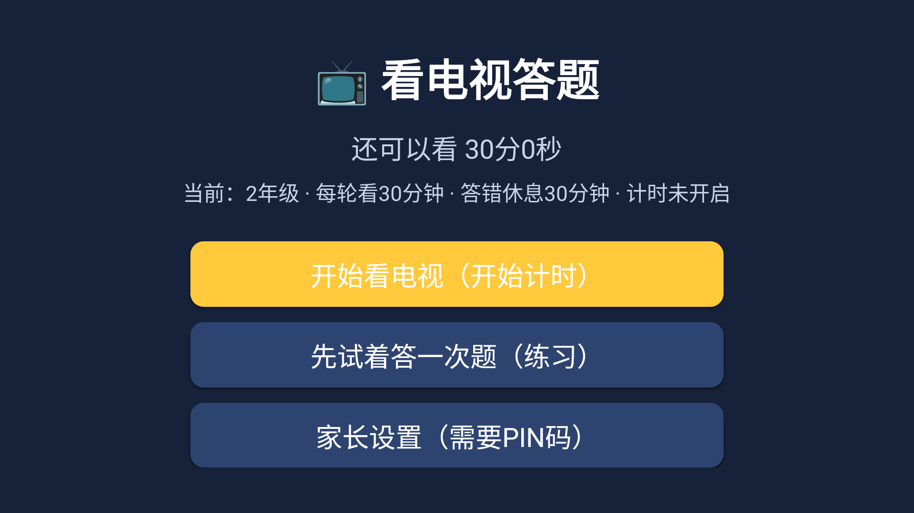
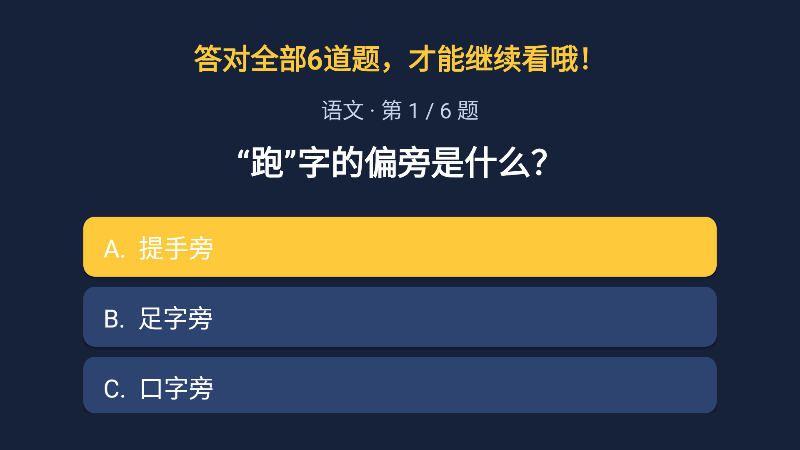
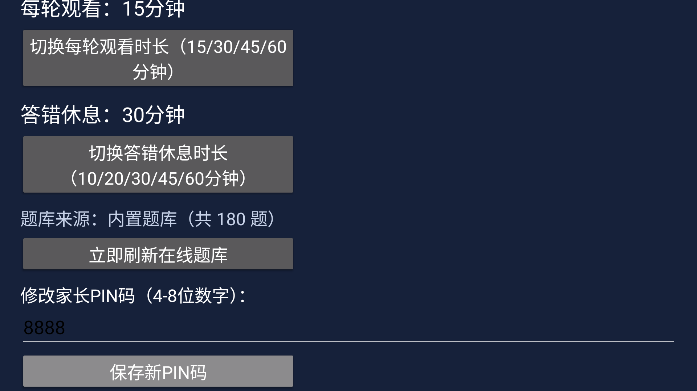

# 看电视答题 TV Quiz Gate

给小学生用的安卓电视“看电视先答题”家长控制 App：看满设定时长后全屏弹出 6 道题（语文、数学、英语各 2 道），全部答对才能继续看，答错就锁屏休息。

为家里小学 1–6 年级的孩子设计，家长按自家孩子情况选年级：遥控器方向键就能操作，大字、全屏，不需要注册账号。题目实时从开源题库 ChinaTextbookStudyFree 抓取（经 jsDelivr 等多条线路，国内网络也能拉），App 在电视端自动清洗筛选成四选一；没网时用内置题库兜底，断网也能正常出题。

> 面向最终用户的安装步骤请看 [README_安装说明.md](README_安装说明.md)。

## 功能 Features

- ⏱️ **前台服务计时**：屏幕亮起时累计观看时长（默认 30 分钟），开机自启动（BootReceiver），计时状态持久化
- 📚 **三科答题**：每轮语文 + 数学 + 英语各 2 题（共 6 题），四选一，遥控器 D-pad 友好；返回键不能关掉答题页
- 🔒 **答错锁屏**：任意一题答错即锁屏（默认 30 分钟），锁屏结束时间以时间戳存入 SharedPreferences，**重启不失效**
- 👨‍👩‍👧 **家长 PIN**：默认 `8888`，可修改（4–8 位）；长按菜单键或点“家长入口”呼出，可临时解锁，也可进入家长设置
- ⚙️ **家长设置**：精确年级（1–6 年级，默认 2 年级）、每轮观看时长（15/30/45/60 分钟）、休息时长（10/20/30/45/60 分钟）、改 PIN、重置/停止监控
- 📖 **实时抓取开源题库 + 内置兜底**：App 启动时按当前年级从开源题库 [ChinaTextbookStudyFree](https://github.com/wuwangzhang1216/congcong-school)（MIT 协议）下载该年级三个科目的题目文件，在电视端清洗筛选（只留四选一、答案归一化、公式转纯文本、去掉依赖课文材料的题），按年级缓存到本地；实测清洗后每个年级每科约 500–1400 道（2026-11-15 实测：三年级全量清洗 语文 996 / 数学 1411 / 英语 889；App 实际走的 jsDelivr 探测路径清洗 三年级 语文 996 / 数学 732 / 英语 535、二年级 语文 797 / 数学 639）。下载不依赖 GitHub 本站：先经 data.jsdelivr.com 查最新发版标签，再按教材文件名直接在 jsDelivr CDN（cdn/fastly/gcore 三个节点）探测下载该年级的题目文件；仅当探测到的题太少时才兜底走 GitHub API 清单 + 直连/镜像。抓取失败/断网时静默用内置 180 题兜底，出题功能永远可用。内置题库每个年级 30 题（每科 10 题）；随机抽题，最近出过的题短期不重复。家长设置页会显示当前题库来源（在线题库（开源仓库）/内置题库）和题目数，也可手动点「立即刷新在线题库」。**注意**：上游题目为 AI 生成、未经教师逐题审核（已做自动清洗和抽查，但不保证每题难度都恰当）；上游英语只有 3–6 年级（人教 PEP 三年级起点），1–2 年级英语自动用内置题补充，设置页会如实标注
  - 语文：1–3 年级反义词、拼音、量词、简单阅读 / 古诗；4 年级近义词/成语/古诗常识，5 年级成语典故、修辞（比喻/拟人）、名著常识，6 年级文言文小句常识、四大名著、病句辨析
  - 数学：1 年级 20 以内，2 年级 100 以内进位加减，3 年级 100 以内 + 简单乘法，4 年级三位数乘两位数、大数认识、简单分数加减，5 年级小数乘除、分数加减、简易方程初步，6 年级分数乘除、百分数、比例初步、圆的周长
  - 英语：1 年级颜色/水果，2 年级水果/动物，3 年级简单句子，4 年级一般现在时简单句、日常词汇，5 年级比较级、过去时、频率副词，6 年级将来时、介词搭配
- 📺 **Android TV 友好**：Leanback Launcher 入口、无需触屏、横屏大字；同时带普通 Launcher 入口，普通安卓盒子也能用
- 🌐 **联网权限只用于题库**：申请了 INTERNET 权限，但只做一件事——从开源仓库下载题目文件；无广告、无统计、不上传任何数据

## 截图 Screenshots

以下截图来自安卓电视模拟器（Android TV 13）全流程实测：

| 首页 | 答题页 | 锁屏页 | 家长设置 |
| --- | --- | --- | --- |
|  |  |  |  |

## 构建 Build

环境要求：JDK 17、Android SDK platform 34 + build-tools 34.0.0。

### 方式一：Gradle（常规）

```bash
# 在 local.properties 里写 sdk.dir=/path/to/android-sdk（该文件已 gitignore）
./gradlew assembleDebug
# 产物：app/build/outputs/apk/debug/app-debug.apk
```

项目为纯 Android 框架实现，**无任何第三方依赖**（无 AndroidX / Kotlin），Gradle 插件版本：AGP 8.3.2，compileSdk 34，minSdk 24，targetSdk 33。

### 方式二：手动打包（无 Gradle 时）

仓库附带 `build_manual.sh`，直接用 `aapt2 + javac + d8 + apksigner` 打包，适合无法下载 AGP 的环境：

```bash
export JAVA_HOME=/path/to/jdk17
export ANDROID_HOME=/path/to/android-sdk
bash build_manual.sh
# 产物：app/build/outputs/apk/debug/app-debug.apk，并复制为根目录 TVQuiz.apk
```

注意：手动脚本首次构建时会在 `.keystore/debug.keystore` 生成一个 debug keystore（已 gitignore，不入库），之后每次构建都复用它，因此连续构建的 APK 签名一致，可以直接覆盖安装升级（v1.3.1 起；更早的版本签名各不相同，从旧版升级到 v1.3.1 仍需先卸载一次）。可用环境变量 `TVQUIZ_KEYSTORE` 指定其他 keystore 路径。

## 安装 Install（摘要）

1. 把 `TVQuiz.apk` 用 U 盘或手机传到电视/盒子
2. 在电视文件管理里点开安装；如被拦截，去设置里给文件管理打开“安装未知应用”
3. 打开 App → 点「开始看电视（开始计时）」，按提示允许通知，并打开「显示在其他应用上层」（悬浮窗）权限——**这一步是必须的**：Android 10 起系统禁止后台应用直接弹出页面，没有这个权限，到时间答题页弹不出来（v1.0 的已知问题，v1.1 已改为点「开始」时自动跳转到该权限的设置页，打开开关后按返回键即可）；另按品牌需要打开使用情况访问、自启动
4. 用家长 PIN `8888` 进入家长设置，先改 PIN，再选年级

完整图文步骤见 [README_安装说明.md](README_安装说明.md)。

## 题库来源 Question Bank Source

题目不自建、不打包固定题库，而是**实时抓取开源题库**：

- 上游：[ChinaTextbookStudyFree](https://github.com/wuwangzhang1216/congcong-school)（原名 ChinaTextbookStudyFree，现仓库名 congcong-school），MIT 协议，按人教版/统编版教材分年级分单元组织，题目为 AI 生成、未经教师逐题审核
- 抓取：App 按所选年级，先用 data.jsdelivr.com 的版本接口解析上游最新发版标签，再按教材文件名（`{系列}{年级}{册次}_unitN.json`）直接在 jsDelivr CDN 上探测并下载该年级语数外三科的题目 JSON（jsDelivr 的清单接口对该仓库超 50MB 上限不可用，故不用清单；探测全程不访问 github.com），在电视端清洗成四选一后按年级缓存；仅当探测题量不足时才兜底使用 GitHub API 清单 + 直连/镜像。上游发新版后，App 下次刷新就会跟到新标签的题，不用重装 App
- 确认是否生效：家长设置页会显示「题库来源：在线题库（开源仓库）（X 年级共 N 题）」；显示「内置题库」说明本次没抓到（没网或线路不通），不影响答题
- 英语 1–2 年级上游没有（PEP 三年级起点），自动用内置英语题，设置页会标注「其中英语为内置题库」

抓取地址写在 `QuestionFetcher.java` 的常量 `UPSTREAM_REPO` / `LISTING_URLS` / `FILE_BASES`，换源时改这几处重新打包即可。

## 默认值 Defaults

| 项目 | 默认值 |
| --- | --- |
| 家长 PIN | `8888` |
| 年级 | 2 年级 |
| 每轮观看 | 30 分钟 |
| 答错休息 | 30 分钟 |

## v1.4 修复（2026-11-24）

- **选中项与未选中项分不清**：PIN 键盘等程序化创建的按钮用的是系统默认样式，聚焦时只是灰色略浅一号，电视上根本看不出选中了哪个；答题页聚焦选项则是黄底浅字、对比同样不足。v1.4 全 App 按钮统一焦点样式：聚焦 = 黄底 + 深色字，未聚焦 = 深蓝底 + 白字（新增 `res/color/btn_text.xml` 文字颜色选择器，与 `btn_bg` 背景选择器配对），覆盖答题、首页、锁屏、PIN 键盘、家长设置和时间到弹窗。

## v1.3.1 修复（2026-11-24）

- **新版无法覆盖安装旧版**：手动构建脚本原来每次都生成一把新的 debug 签名密钥（且放在每次构建都会清空的目录里），导致每个 APK 签名都不同，安卓以「签名不一致」拒绝覆盖安装，必须先卸载旧版。v1.3.1 改为固定复用 `.keystore/debug.keystore`（可用 `TVQUIZ_KEYSTORE` 覆盖路径），此后构建的 APK 可直接覆盖升级。注意：从 v1.3 及更早版本升级到 v1.3.1 时，因旧版签名是随机的，仍需最后卸载一次。

## v1.3 修复（2026-11-24）

- **选项文字上下被裁**：v1.1 给选项按钮定了 56dp 固定高度，而按钮背景图 `btn_bg` 的 shape 自带上下各 14dp 内边距、再叠加按钮自身内边距后，留给 26sp 文字的高度不足一行，汉字下半截被切掉（例：「黑乎乎」的「黑」被切得像「里」）。v1.3 去掉背景图的内边距，所有按钮改「高度自适应 + 最小高度」并把内边距放到按钮本身，文字再长、字号再大按钮都会跟着长高（页面可滚动兜底）。

## v1.2 修复（2026-11-24）

- **按 OK 键时间少一秒**：首页默认焦点在「开始看电视」按钮上，按 OK 就会重新启动计时服务，而服务每次启动都会立即跑一次计时 tick、旧逻辑每次 tick 无条件 +1 秒，于是按一次 OK 就少一秒（返回首页同理）。v1.2 改为按真实流逝时间（时间戳差值）累计观看时长，立即执行的 tick 只记 0 秒；同时「开始」按钮改为幂等，已在计时时再按只提示、不重启服务。

## v1.1 修复（2026-11-24）

- **强制弹窗**：v1.0 到时间不弹窗的根因是 Android 10+ 禁止后台应用 `startActivity`（系统静默拦截、不抛异常），而看电视时本 App 恰恰在后台；且申请悬浮窗权限的函数当时是空实现。v1.1 改为三通道：直接拉起页面 → 全屏意图通知 → 悬浮窗全屏门（`OverlayGate`，盖住整个屏幕、只能点「开始答题」进入）；点「开始看电视」时会自动引导开启悬浮窗权限，首页也会显示该权限是否已开启。
- **TV 适配**：答题页原布局在低高度屏幕（如 960×540 / 720p 模拟器，可见高度约 540dp）总高度溢出且不可滚动，D 选项和家长按钮被裁掉。v1.1 答题/首页/锁屏页改为可滚动布局 + 紧凑尺寸，遥控器焦点会自动把选项滚入可见区；PIN 页与家长设置页修掉了把原始像素（px）当 dp 写死的问题（200×110px 按键、760px 宽按钮），改为 dp + 全宽。

## 已知限制 Limitations

- 未做 Device Owner 配置，因此不是 kiosk 级强锁：Home 键在部分品牌上仍可回桌面（计时/锁屏仍会再次拉起全屏页，倒计时不会清零）。真正的锁任务模式（Lock Task）需要 Device Owner 部署。
- 强制弹窗依赖悬浮窗权限：未开启时只能靠全屏通知提醒，无法盖住正在播放的画面；个别深度定制系统还需另开「后台弹出界面」权限。
- 本 App 为 debug 签名分发，仅供家庭自用；上架应用商店需换正式签名并做隐私合规。

## 结构 Structure

```
app/src/main/java/com/sunzhe/tvquiz/
├── MainActivity.java            # 首页 / 状态 / 启动计时
├── WatchService.java            # 前台计时服务
├── QuizActivity.java            # 答题页（6 题，每科 2 题，全对解锁）
├── LockActivity.java            # 锁屏倒计时页
├── PinActivity.java             # 屏幕数字 PIN 键盘
├── ParentSettingsActivity.java  # 家长设置
├── QuestionBank.java            # 内置题库（180 题）+ 在线题库按科切换/兜底
├── QuestionFetcher.java         # 开源题库多线路抓取 / 端上清洗 / 按年级缓存
├── Question.java / Prefs.java   # 题型 / 持久化
└── BootReceiver.java            # 开机自启、锁屏恢复
```

## License

[MIT](LICENSE)
